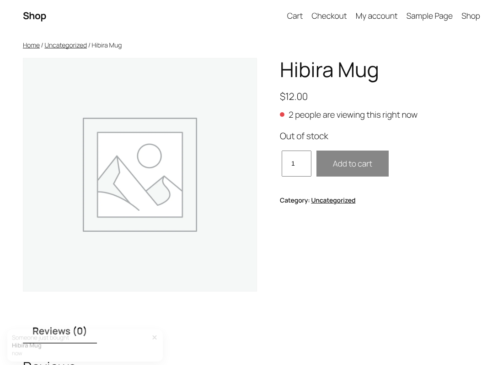

# Hibira Live Visitors for WooCommerce

Real "3 people are viewing this right now" counts, "Someone just bought" popups and live stock on WooCommerce product pages. Every number is an open browser tab counted by [Hibira](https://hibira.io/?utm_source=github&utm_medium=readme&utm_campaign=woocommerce), so nothing is made up.



## What it does

- **Product viewers.** A badge under the price shows how many shoppers have the product open. It hides below a threshold you pick (2 by default).
- **Store-wide count.** `[hibira_viewers scope="store"]` shows how many shoppers are on the shop right now.
- **Purchase popups.** When an order is paid, open pages show "Someone just bought" with the product. A visitor who arrives later sees one recent order (24 hours by default). No customer names or places are sent.
- **Live stock.** "Only 2 left in stock" and "Out of stock" update on open product pages as orders come in, and the add to cart button is disabled when the product sells out.

It works with classic and block themes and is compatible with HPOS and the cart and checkout blocks.

## Requirements

- WordPress 6.5+, WooCommerce 8.0+, PHP 7.4+
- A Hibira app with **subscription counting** turned on (Free works: 100 connections)

## Setup

1. Install and activate the plugin.
2. Create an app at [hibira.io](https://hibira.io/?utm_source=github&utm_medium=readme&utm_campaign=woocommerce) and turn on **Subscription count** in the app's settings.
3. Open **WooCommerce → Settings → Live visitors**, paste the App ID, key and secret, save, and press **Send test event**.

You can keep the credentials out of the database with constants in `wp-config.php`:

```php
define( 'HIBIRA_APP_ID', '...' );
define( 'HIBIRA_APP_KEY', '...' );
define( 'HIBIRA_APP_SECRET', '...' );
```

## Shortcode

```
[hibira_viewers]                 viewers of the current product
[hibira_viewers scope="store"]   shoppers on the whole shop
[hibira_viewers min="1"]         show from one viewer
```

## How it works

Each product page subscribes to a public channel for the product and, when the store-wide count is on, one for the store. Hibira sends the channel's subscriber count to every open tab, so the badge is the real number of tabs. Paid orders and stock changes are sent from WordPress after the response is finished, so checkout is not slowed down.

Filters: `hibira_lv_load` (load the script on more pages) and `hibira_lv_client` (replace the HTTP client).

## Development

`tests/e2e/live-visitors.cjs` drives three shoppers with Playwright against a local WordPress + WooCommerce and a local Hibira server: viewer counts, a tab leaving, a stock change, a paid order (popup, out of stock, disabled button) and a later visitor's popup.

## License

GPL-2.0-or-later

---

## 中文摘要

Hibira Live Visitors 為 WooCommerce 商品頁加上真實的「現在有 3 人正在看」、「有人剛買了」彈窗和即時庫存。所有數字都是 Hibira 數出的真實開啟分頁，不造假。

安裝後在 Hibira 建立 app 並開啟 **Subscription count**，到 **WooCommerce → 設定 → Live visitors** 貼上 App ID、key、secret 並送出測試事件即可。也可用 `wp-config.php` 的 `HIBIRA_APP_*` 常數設定。全站人數用短代碼 `[hibira_viewers scope="store"]`。支援區塊佈景主題與 HPOS，免費方案（100 連線）即可使用。後台介面支援英文、繁中、簡中、日、韓、泰、越。
