# Hibira Live Visitors para WooCommerce: tutorial en español

Muestra en tu tienda WooCommerce cuántas personas están viendo cada producto, avisos de «Alguien acaba de comprar» y el stock actualizado al momento. Todos los números son pestañas del navegador abiertas de verdad, contadas por [Hibira](https://hibira.io/?utm_source=github&utm_medium=tutorial&utm_campaign=woocommerce-es). Nada es inventado.

La configuración lleva unos cinco minutos y el plan Free de Hibira (100 conexiones simultáneas) es suficiente para empezar.

[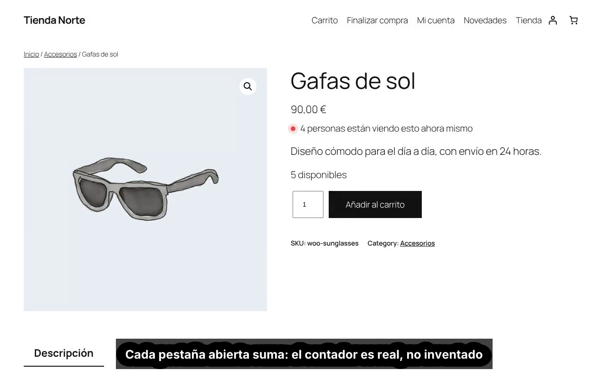](tutorial.mp4)

▶️ [Ver el vídeo (57 s, con subtítulos en español)](tutorial.mp4) · [Subtítulos .srt](tutorial.es.srt)

## Lo que verán tus clientes

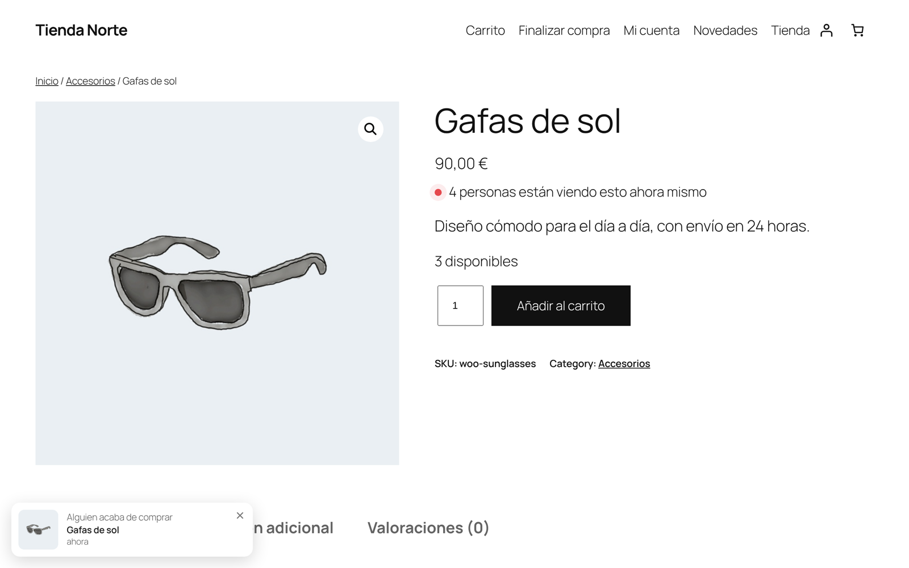

- **Visitantes del producto.** Debajo del precio aparece «4 personas están viendo esto ahora mismo». Se oculta por debajo del mínimo que elijas (2 por defecto), así nunca verás «1 persona» en un producto tranquilo.
- **Avisos de compra.** Cuando se paga un pedido, las páginas abiertas muestran «Alguien acaba de comprar» con el producto. Quien llega más tarde ve un pedido reciente (de las últimas 24 horas por defecto). No se envían nombres ni ubicaciones de clientes.
- **Stock en vivo.** «3 disponibles» y «Sin existencias» cambian en las páginas abiertas a medida que entran pedidos, y el botón de compra se desactiva cuando se agota.
- **Recuento de toda la tienda.** Con el shortcode `[hibira_viewers scope="store"]` muestras cuántas personas están comprando en la tienda ahora mismo.

## Requisitos

- WordPress 6.5 o superior, WooCommerce 8.0 o superior y PHP 7.4 o superior.
- Una cuenta gratuita en [hibira.io](https://hibira.io/?utm_source=github&utm_medium=tutorial&utm_campaign=woocommerce-es).

Funciona con temas clásicos y de bloques, con HPOS y con los bloques de carrito y pago.

## Paso 1: crea una app en Hibira

Entra en tu panel de Hibira, abre **Apps** y pulsa **Create app**. Ponle el nombre de tu tienda y escribe la dirección de tu web (por ejemplo `https://mitienda.es`). Solo los navegadores que vienen de esa dirección podrán conectarse.

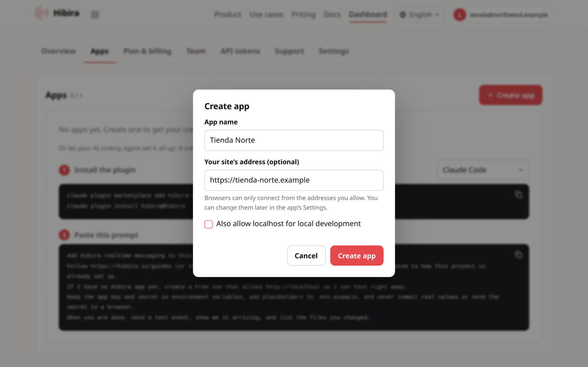

Al crearla verás sus credenciales. Copia el **App ID**, la **Key** y el **Secret**: el Secret solo se muestra esta vez.

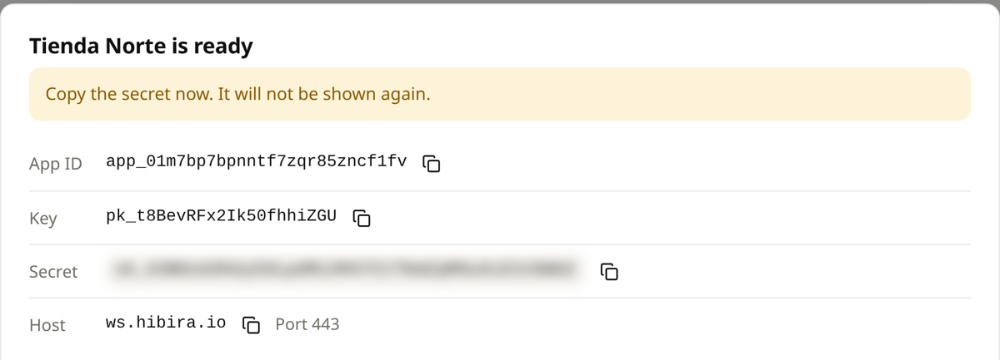

## Paso 2: activa el recuento de visitantes

En la pestaña **Settings** de la app, marca **Send subscriber counts** y pulsa **Save**. Es lo que permite contar cuántas pestañas tienen abierto cada producto. Comprueba también que la dirección de tu tienda aparece en **Allowed origins**.

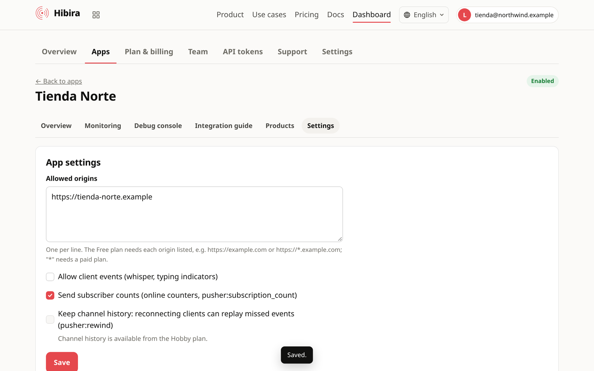

## Paso 3: instala el plugin en WordPress

En WordPress ve a **Plugins › Añadir plugin**, busca «Hibira Live Visitors», pulsa **Instalar ahora** y luego **Activar**.

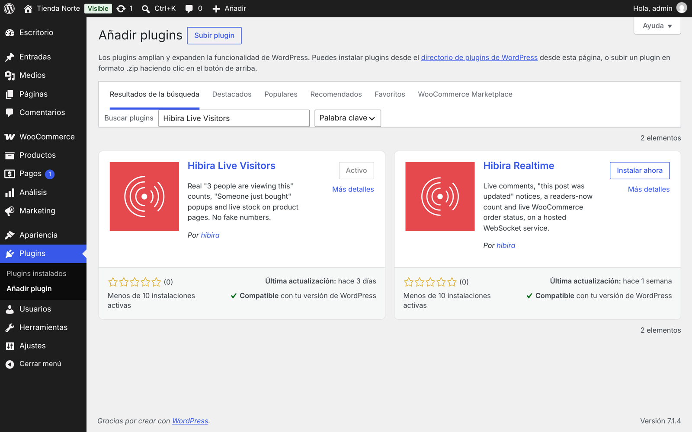

## Paso 4: pega las credenciales

Abre **WooCommerce › Ajustes › Visitantes en vivo**, pega el App ID, la Key y el Secret y pulsa **Guardar cambios**. Deja el Host en `ws.hibira.io`. En la misma página eliges qué ven los compradores: el contador de visitantes y desde cuántas personas aparece, el recuento de toda la tienda, los avisos de compra y su posición, y el stock en vivo.

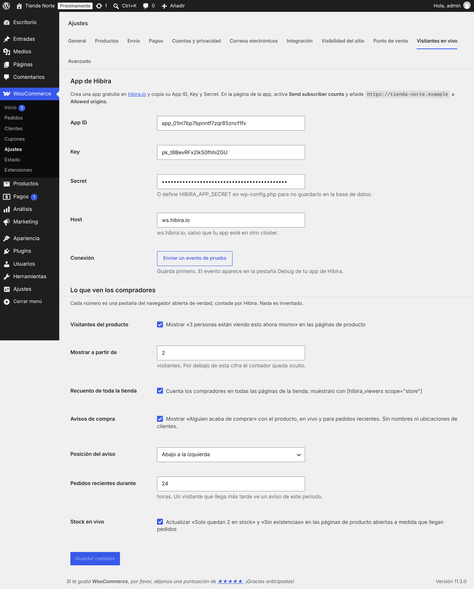

Si prefieres no guardar las claves en la base de datos, defínelas en `wp-config.php`:

```php
define( 'HIBIRA_APP_ID', '...' );
define( 'HIBIRA_APP_KEY', '...' );
define( 'HIBIRA_APP_SECRET', '...' );
```

## Paso 5: comprueba la conexión

Pulsa **Enviar un evento de prueba**. WordPress confirma el envío:

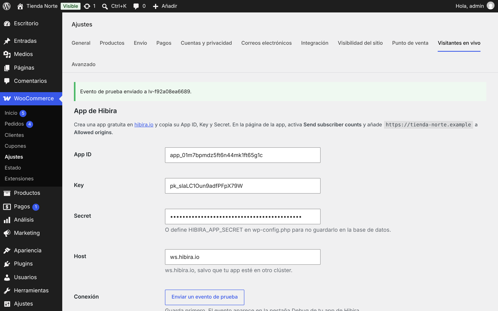

Y el evento aparece al instante en la pestaña **Debug console** de tu app en Hibira:

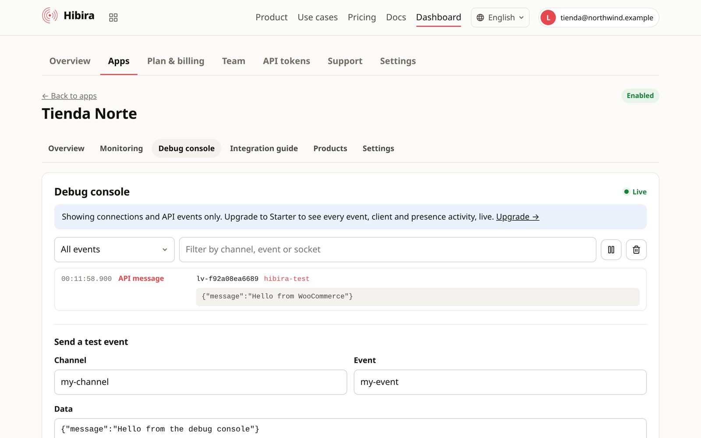

¡Listo! Abre un producto en dos o tres pestañas y verás el contador subir.

## Más ejemplos

El recuento de toda la tienda en una página con `[hibira_viewers scope="store" min="1"]`, junto al aviso del último pedido que ve un visitante nuevo:

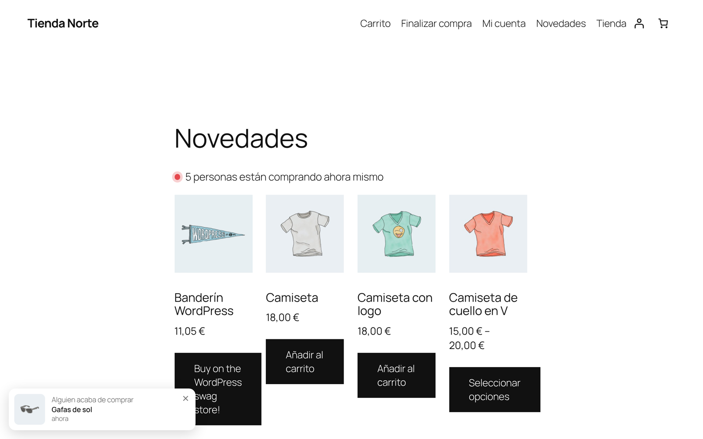

Cuando se vende la última unidad, todas las páginas abiertas pasan a «Sin existencias» y el botón de compra se desactiva, sin recargar:

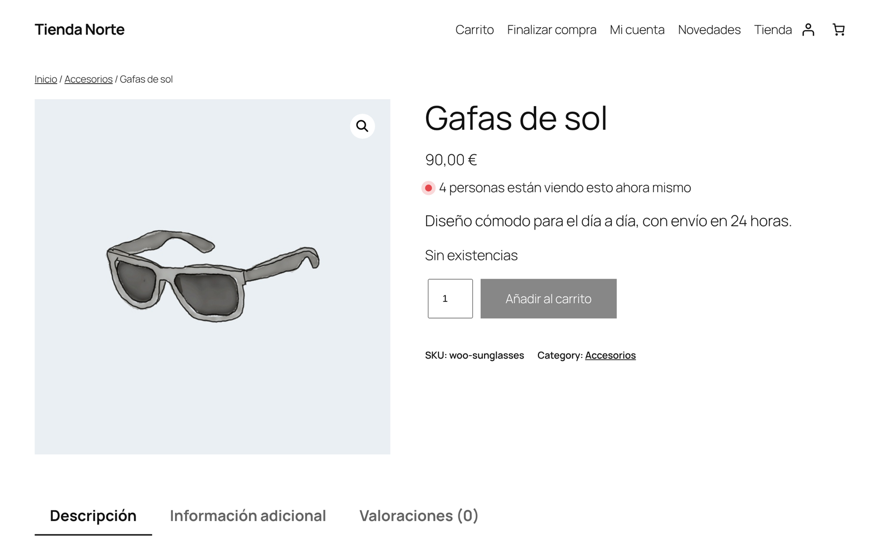

También en el móvil:

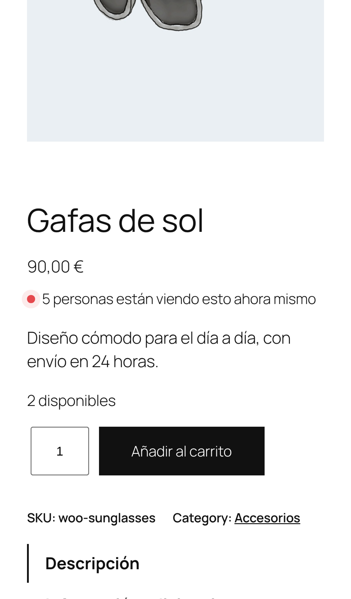

## Shortcode

```
[hibira_viewers]                 visitantes del producto actual
[hibira_viewers scope="store"]   compradores en toda la tienda
[hibira_viewers min="1"]         mostrar desde una persona
```

## Preguntas frecuentes

**¿Los números son reales?**
Sí. El contador es el número de pestañas abiertas en ese producto, según Hibira. Nunca suma ni redondea hacia arriba.

**¿Ralentiza el pago?**
No. Los eventos se envían cuando WordPress ya ha terminado de responder al cliente.

**¿Qué datos se envían?**
Los navegadores se conectan a Hibira con el nombre de un canal (un hash de la URL de la tienda y el ID del producto). Tu servidor envía los pedidos pagados (producto, nombre, enlace, imagen y hora) y el estado del stock. No se envía ningún dato de clientes. Consulta los [términos](https://hibira.io/legal/terms) y la [política de privacidad](https://hibira.io/legal/privacy).

**¿Cuánto cuesta?**
El plan Free de Hibira incluye 100 conexiones simultáneas, suficiente para la mayoría de tiendas pequeñas. Si tu tienda crece, los planes de pago están en [hibira.io/pricing](https://hibira.io/pricing?utm_source=github&utm_medium=tutorial&utm_campaign=woocommerce-es).

---

¿Dudas? Escríbenos a support@hibira.io.

Hibira
